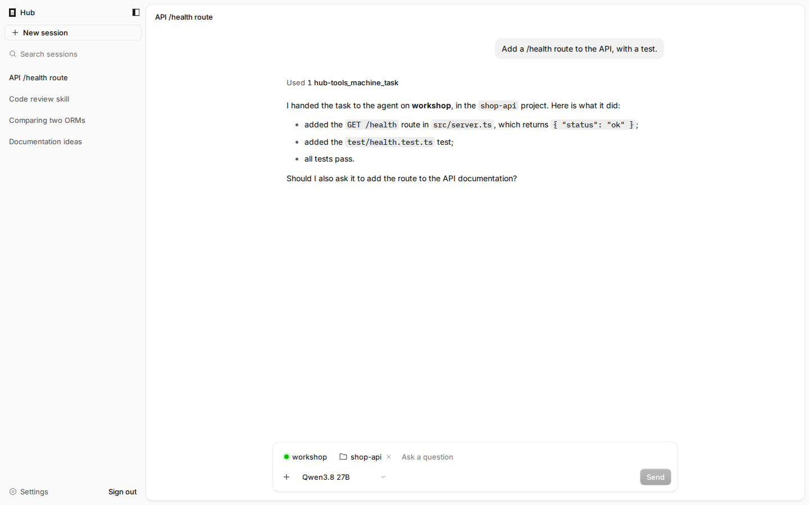
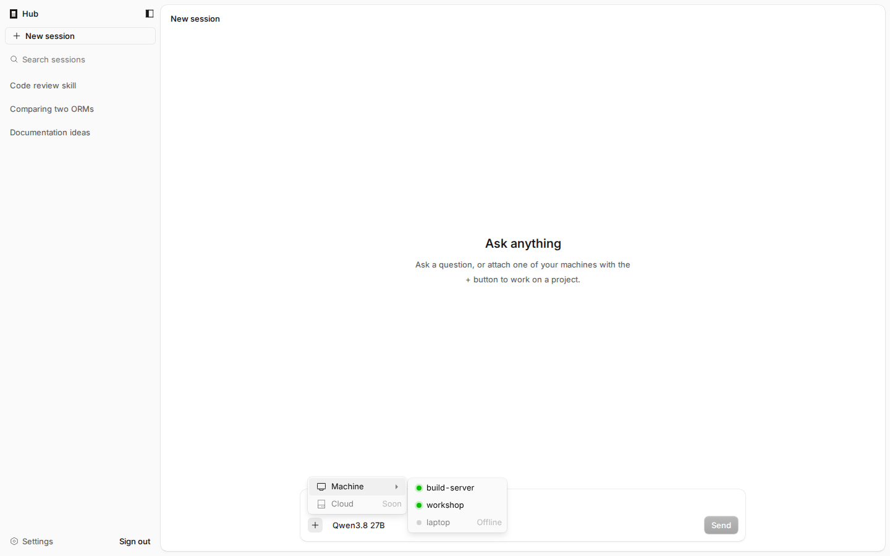
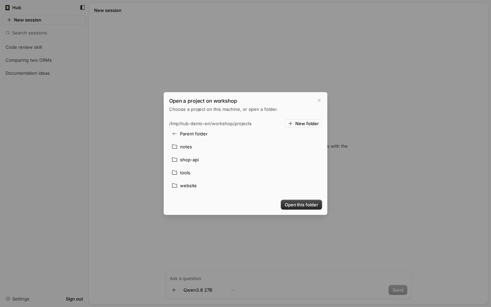
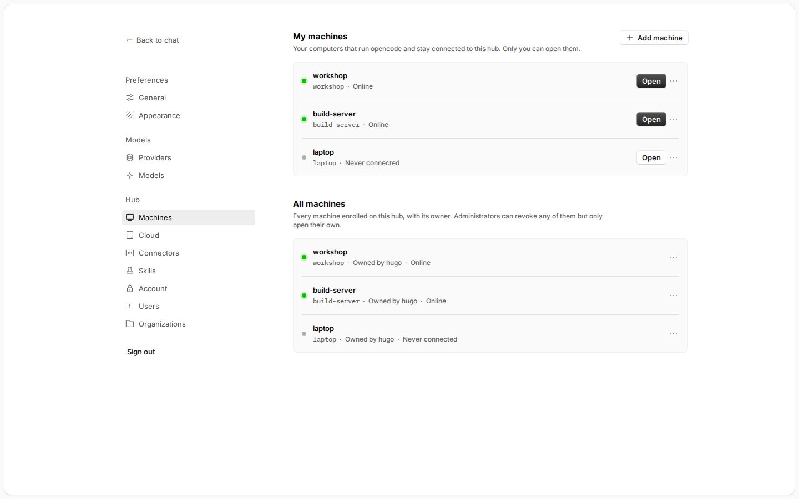
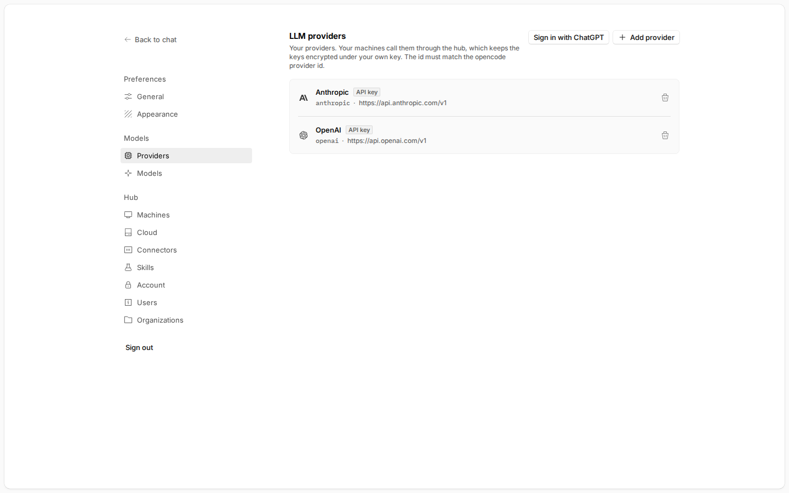

<h1 align="center">opencode-hub</h1>

<p align="center">
  <a href="README.md">Français</a> |
  <a href="README.en.md">English</a>
</p>

<p align="center">
  A fork of <a href="https://github.com/anomalyco/opencode">OpenCode</a> that adds a <strong>hub</strong>:
  a public instance, on a VPS, with a chat that hands your tasks to the agents of all your machines.
</p>

<p align="center">
  
</p>

> [!IMPORTANT]
> **Independent project.** opencode-hub is not built by the OpenCode team and is not affiliated with them in any way.
> It is maintained separately; for questions or issues about the hub, use this repository, not the OpenCode project.

> [!NOTE]
> **Tested and working on a VPS.** The hub runs on an Ubuntu 26.04 VPS behind Caddy, with Linux machines connected as
> clients. The project is still evolving: the interfaces, the protocol and the data format may change from one
> pre-release to the next.

## Why

OpenCode runs on the machine that holds the code. This fork lets you install a main instance on a server reachable from
the Internet and attach as many machines as you like to it (workstation, build server, compute machine…), even behind
NAT, without opening any port on them. From a single chat, you hand a task to one of them, or open its full OpenCode
interface to work as if you were in front of it.

## Features

- **Hub chat**: the home page is a chat in OpenCode's style, with its sessions, search and model choice. Only your own
  providers answer it, and it can neither read files nor run commands on the hub.
- **Tasks on your machines**: the **+** button ties the conversation to a connected machine and one of its projects (or
  a new folder created from the hub). That machine's agent does the work, and the chat summarizes it for you.
- **Skills from the chat**: ask the chat to create a skill or to install those of a GitHub repository; they reach all of
  your machines.
- **Secure hub**: accounts created by invitation, OPAQUE sign-in (the password never leaves the browser), automatic
  HTTPS (Let's Encrypt through Caddy).
- **Remote machines**: each machine runs `opencode agent run`, which keeps an outgoing WebSocket tunnel to the hub. No
  port to open; NAT and firewalls are not a problem.
- **Each machine's full interface**: `https://<machine>.hub.example.com` shows the OpenCode web interface of the
  machine itself, through the tunnel (sessions, files, terminal, diffs).
- **LLM proxy and MCP relay**: provider keys and MCP connector secrets stay encrypted on the hub. Machines only hold a
  hub-specific token; changing a key requires nothing on the machines.
- **Several users**: each has their own machines, providers and skills; organizations share their machines between
  members.
- **Provider catalog**: more than 200 providers from the OpenCode catalog, with the API URL already filled in. "Sign in
  with ChatGPT" is available.
- **All of OpenCode's languages**: the interface is translated into OpenCode's 62 languages.
- **Cloud instances** *(experimental)*: LXD servers linked to the hub
  ([`agent-hub-lxd`](https://github.com/h082-orion/agent-hub-lxd)), on which each user creates ready-to-use machines.
  See [`specs/cloud.md`](specs/cloud.md).

<p align="center">
  
  
</p>
<p align="center">
  
  
</p>

## Install

One command, without cloning the repository. It asks its questions one by one, downloads the latest published version,
and runs again as is to update:

```bash
curl -fsSL https://raw.githubusercontent.com/H082-ORION/opencode-hub/remote-machines/install.sh | bash
```

It asks for administrator rights (`sudo`) when needed, then what you want to do:

| Choice | For |
|---|---|
| **Install a public hub on this server** | A VPS: Caddy and the hub, over HTTPS |
| **Connect this machine to a hub** | Each machine that will work for the hub |
| **Install a local hub, without HTTPS** | A trial on your computer |
| **Choose the components one by one** | Other cases |

### 1. The hub, on the VPS

1. Point the hub's domain **and** its subdomains at the VPS: an A record (and AAAA for IPv6) for `hub.example.com` and
   for `*.hub.example.com`. If your DNS provider cannot create `*.hub.example.com` (OVH, for example), the installer can
   place the machines at `<machine>.example.com`, which only needs `*.example.com`.
2. Open ports **80** and **443** (the installer opens them in `ufw`; also check your host's firewall).
3. On the VPS, run the command above and choose **Install a public hub on this server**. Give the domain
   (`hub.example.com`) and an e-mail address for the certificates; the other questions have default answers.
4. At the end, the installer prints **once** the link that creates the administrator account. Open it to create the
   account. The first load takes a few seconds, while Caddy obtains the certificate.
5. In **Settings › Providers**, add at least one model provider.

> [!WARNING]
> With `*.example.com`, a subdomain declared by name in the DNS (`www`, `mail`…) wins over the wildcard and does not
> reach the hub: don't give a machine the name of such a subdomain. If `*.example.com` already points elsewhere, it
> must point to the VPS.

> [!TIP]
> The hub must be served over HTTPS: on a plain `http://` address other than `localhost`, the browser blocks the
> password encryption and creating the account fails. The order does not matter: installing Caddy or the hub first
> leads to the same result, since the installer always ties one to the other.

### 2. Each machine

1. In the hub, **Settings › Machines › Add machine**: a one-time code is shown.
2. On the machine, run the same command and choose **Connect this machine to a hub**. Give the hub's URL
   (`https://hub.example.com`), then the code. Accept the systemd service so the machine stays connected across reboots.
3. The machine shows up as connected in the hub. In the chat, **+** › **Machine** hands it tasks.

### Update, status, uninstall

| Command | Purpose |
|---|---|
| `curl … \| bash` | Update: choose the same installation again; the latest version is offered first |
| `curl … \| bash -s -- --status` | Status of Caddy, the hub, the agent and the binary |
| `curl … \| bash -s -- --uninstall` | Uninstall (`--purge` also deletes the data, the enrollment, Caddy and the binary) |
| `curl … \| bash -s -- --help` | Every option, for an install without questions |

Without any question, for example on a server provisioned by a script:

```bash
curl -fsSL https://raw.githubusercontent.com/H082-ORION/opencode-hub/remote-machines/install.sh \
  | bash -s -- --caddy --hub --domain hub.example.com --email you@example.com --service --download --yes
```

The published binaries cover Linux x64 and arm64 (glibc). Details on Caddy, DNS and troubleshooting:
[`script/hub/README.md`](script/hub/README.md).

## Architecture

```
browser ──https──> Caddy ──> opencode hub (127.0.0.1:4800)
                               ├─ hub.example.com            chat, settings, login, LLM and MCP proxy
                               └─ <machine>.hub.example.com  proxy to the machine (domain configurable: --machine-domain)
                                         ▲
                       outgoing WebSocket tunnel (opened by the machine)
                                         │
          machine: opencode agent ──> local opencode service (127.0.0.1)
```

Each machine runs a full OpenCode server: Git, terminal, files and tools run locally. The hub authenticates, routes
and relays. Its chat relies on one OpenCode instance per user, stripped of every tool but the hub's own (skills, tasks
on the machines). The OpenCode core is not modified. The protocol is detailed in
[`specs/remote-machines.md`](specs/remote-machines.md).

## Develop

Prerequisite: [Bun](https://bun.sh) (version given in `package.json`).

```bash
./build.sh                    # dependencies, tests, web UI and binary for this machine
BIN=packages/cli/dist/cli-linux-x64/bin/opencode

$BIN hub                      # http://localhost:4800; without accounts, prints the link that creates the administrator
$BIN agent join http://localhost:4800      # on a machine: asks for the code without echo
$BIN agent run
```

From source without a binary: `./build.sh --ui-only`, then `bun run dev hub` and `bun run dev agent run`. A new version
is published with `./release.sh <version>` (for example `1.0.0-pre.4`, or `1.0.0` for a stable one).

## Commands

| Command | Purpose |
|---|---|
| `opencode hub [--port 4800] [--url https://hub.example.com] [--machine-domain example.com] [--data <folder>] [--mcp-private-network]` | Starts the hub (`--machine-domain`: machines at `<machine>.example.com` instead of `<machine>.hub.example.com`; `--mcp-private-network`: MCP connectors may reach private and loopback addresses) |
| `opencode hub invite [--admin] [--data <folder>]` | Creates a one-time invitation and prints its link (`--admin` for an administrator) |
| `opencode agent join <url> [--code <code>] [--name <name>] [--insecure]` | Enrolls this machine (without `--code`, the code is asked without echo or read from stdin) |
| `opencode agent run` | Keeps the machine connected to the hub |
| `opencode agent status` / `opencode agent leave` | Enrollment status / unenroll |

## Enrollment security

The enrollment code, and the tokens the hub sends back to the machine, only travel over HTTPS: `opencode agent join`
and `install.sh` refuse a plain `http://` URL to another machine (only `localhost`, `*.localhost`, `127.x.x.x` and
`::1` stay allowed over HTTP, for local tests). They also refuse a hub that announces a plain `http://` public URL,
since the tunnel would send the machine's token in clear text there. `--insecure` lifts both refusals, knowingly.
Without `--code`, the code shows up neither in the process list nor in the shell history.

## Known limits

- An offline machine is not reachable: its sessions live on the machine.
- During a task handed to a machine, the chat shows the running tool, without detailed progress; since nobody can
  answer from the hub, the remote agent's permission requests are refused and reported in its answer.
- The chat history is stored in clear on the hub, in each user's private folder.
- Hub login sessions are kept in memory: restarting the hub logs the browser out.
- Anthropic subscriptions cannot go through the hub: OpenCode only uses them through the `claude` CLI installed on each
  machine.
- If a machine already has a key stored for a provider offered by the hub, that local key is used.

## Code layout

| Path | Content |
|---|---|
| `packages/relay` | Hub, chat and its tools, tunnel protocol, agent, LLM proxy, MCP relay, catalog |
| `packages/app/hub.html`, `packages/app/src/hub` | Hub interface (`@opencode/ui` and `@opencode/session-ui` components) |
| `packages/cli/src/commands/handlers/{hub,agent}` | `opencode hub` and `opencode agent` commands |
| `install.sh` | Install, update, status and uninstall (Caddy, hub, client, systemd services) |
| `build.sh`, `release.sh` | Full build, publishing a version |
| `specs/` | Specifications |

## OpenCode

Everything else is [OpenCode](https://github.com/anomalyco/opencode), developed by its team. opencode-hub is not
built by the OpenCode team and is not affiliated with them in any way. The original README is
kept in [`README.opencode.md`](README.opencode.md). This fork follows the upstream `dev` branch; the hub is developed on
the `remote-machines` branch.

License: MIT, like OpenCode ([`LICENSE`](LICENSE)).

## Acknowledgements

A big thank you to the [OpenCode](https://github.com/anomalyco/opencode) team, and congratulations on their excellent
work. opencode-hub would not exist without it: the server, the web interface, the terminal, the provider catalog,
everything the hub makes reachable remotely is OpenCode. Thank you as well for releasing it as open source, which lets
projects like this one build on top of it.
