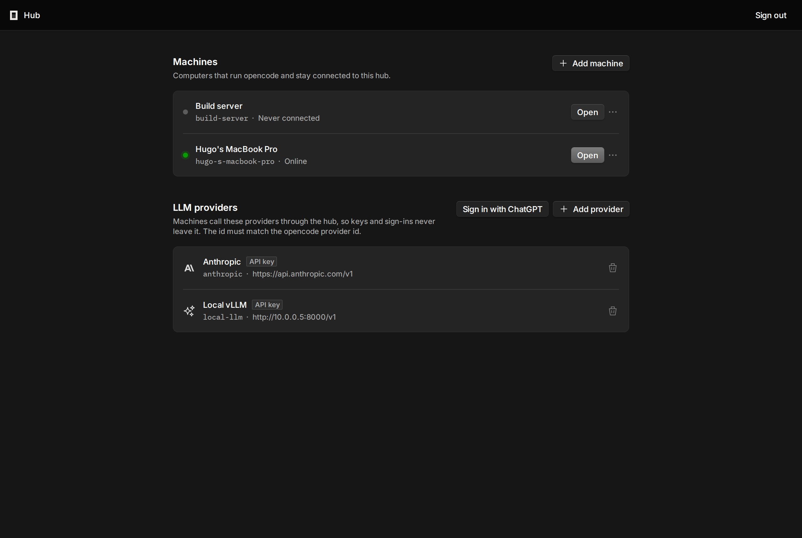
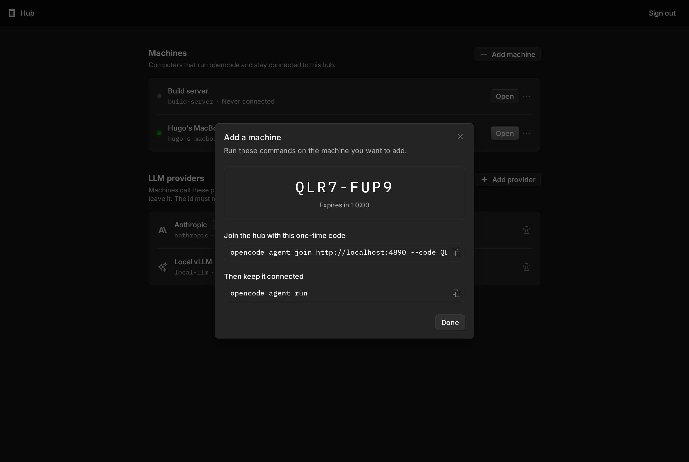
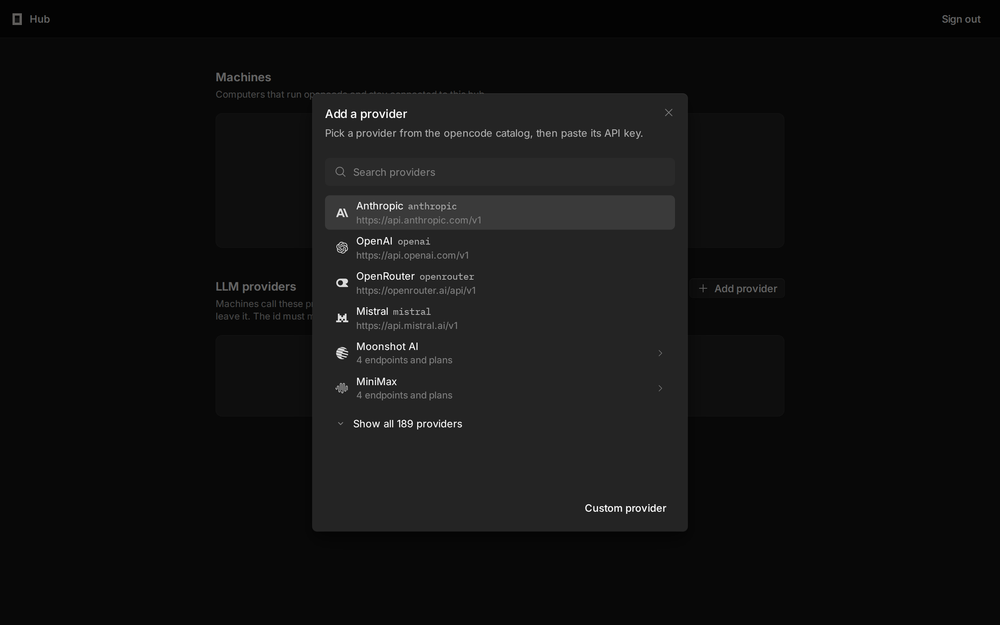
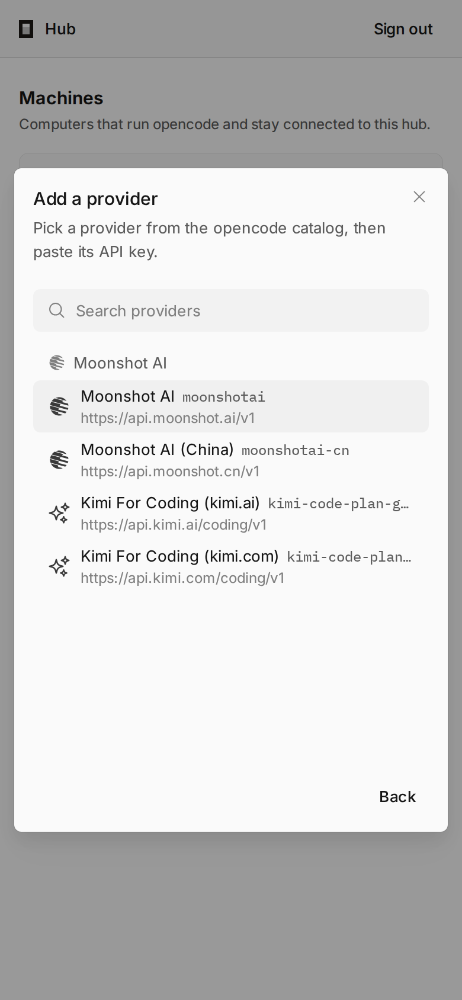

<h1 align="center">opencode-hub</h1>

<p align="center">
  <a href="README.md">Français</a> |
  <a href="README.en.md">English</a>
</p>

<p align="center">
  A fork of <a href="https://github.com/anomalyco/opencode">OpenCode</a> that adds a <strong>hub</strong>:
  a public instance, on a VPS, from which you drive coding sessions on several remote machines.
</p>

<p align="center">
  
</p>

> [!WARNING]
> **Work in progress.** The hub works end to end locally, but has not been proven in production yet. The interfaces,
> the protocol and the data format may still change.

## Why

OpenCode runs on the machine that holds the code. This fork lets you install a main instance on a server reachable from
the Internet and attach as many machines as you like to it (workstation, build server, compute machine…), even behind
NAT, without opening any port on them. From the browser, you pick a machine, then a folder, and work as if you were in
front of it.

## Features

- **Secure hub**: password login, automatic HTTPS (Let's Encrypt through Caddy), one session per browser.
- **Remote machines**: each machine runs `opencode agent run`, which keeps an outgoing WebSocket tunnel to the hub
  (heartbeat, automatic reconnection). No port to open; NAT and firewalls are not a problem.
- **Each machine's full interface**: `https://<machine>.hub.example.com` shows the OpenCode web interface of the
  machine itself, through the tunnel (sessions, files, terminal, diffs, live streams).
- **Simple enrollment**: a one-time code generated from the hub, one command to run on the machine. Each machine gets
  its own token, revocable at any time.
- **LLM proxy**: provider keys stay on the hub. Machines only hold a hub-specific token, which replaces the real key on
  the way. Changing a key requires no action on the machines.
- **Provider catalog**: more than 200 providers from the OpenCode catalog, grouped by company, with the API URL already
  filled in. Only the key remains to paste.
- **ChatGPT subscription**: "Sign in with ChatGPT" on the hub, token renewed automatically *(not yet tested against the
  real OpenAI service)*.

<p align="center">
  
  
</p>

## Architecture

```
browser ──https──> Caddy ──> opencode hub (127.0.0.1:4800)
                               ├─ hub.example.com            dashboard, login, enrollment, LLM proxy
                               └─ <machine>.hub.example.com  proxy to the machine
                                         ▲
                       outgoing WebSocket tunnel (opened by the machine)
                                         │
          machine: opencode agent ──> local opencode service (127.0.0.1)
```

Each machine runs a full OpenCode server: Git, terminal, files and tools run locally. The hub only authenticates,
routes and relays. The OpenCode core is not modified. The protocol is detailed in
[`specs/remote-machines.md`](specs/remote-machines.md).

## Try it locally

Prerequisite: [Bun](https://bun.sh) (version given in `package.json`).

```bash
./build.sh                    # dependencies, tests, web UI and binary for this machine
BIN=packages/cli/dist/cli-linux-x64/bin/opencode

$BIN hub                      # http://localhost:4800, the password is shown once
# In the dashboard: "Add machine", then on the machine:
$BIN agent join http://localhost:4800      # asks for the code without echo
$BIN agent run
# The machine is reachable at http://<machine>.localhost:4800
```

From source without a binary: `./build.sh --ui-only`, then `bun run dev hub` and `bun run dev agent run`.

## Install

`install.sh`, at the root of the repository, installs and sets up the three components. On launch, a menu offers the
language (French or English), then the components to check:

- **Caddy**: HTTPS proxy in front of the hub, on-demand certificates for the hub and for each machine;
- **Hub**: the dashboard;
- **Client**: the agent that connects the machine to a hub.

The hub and the client can be installed as systemd services started at boot.

1. Point `hub.example.com` **and** `*.hub.example.com` at the VPS (A/AAAA records).
2. On the VPS, from this repository:

   ```bash
   sudo ./install.sh                  # menu: language, components, settings
   ```

   The binary is taken from the machine, built from the repository (`./build.sh`) or given as a path. For a server
   with another architecture: `./build.sh --target linux-x64` (or `linux-arm64`), then `--binary <path>`.
3. On each machine to connect, after creating a code in the dashboard ("Add machine"):

   ```bash
   sudo ./install.sh --client --client-url https://hub.example.com --code XXXX-XXXX --service
   ```

| Command | Purpose |
|---|---|
| `./install.sh --status` | Status of Caddy, the hub, the agent and the binary |
| `sudo ./install.sh --uninstall [--purge]` | Uninstall; `--purge` also deletes the data, the enrollment, Caddy and the binary |
| `./install.sh --help` | Every option, for an install without questions (`--yes`) |
| `--lang fr\|en` | Sets the language without the menu (`build.sh` accepts it too) |

Details on Caddy, DNS and troubleshooting: [`script/hub/README.md`](script/hub/README.md).

## Commands

| Command | Purpose |
|---|---|
| `opencode hub [--port 4800] [--url https://hub.example.com] [--data <folder>]` | Starts the hub |
| `opencode hub password` | Resets the hub password |
| `opencode agent join <url> [--code <code>] [--name <name>] [--insecure]` | Enrolls this machine (without `--code`, the code is asked without echo or read from stdin) |
| `opencode agent run` | Keeps the machine connected to the hub |
| `opencode agent status` / `opencode agent leave` | Enrollment status / unenroll |



## Enrollment security

The enrollment code, and the tokens the hub sends back to the machine, only travel over HTTPS: `opencode agent join`
and `install.sh` refuse a plain `http://` URL to another machine (only `localhost`, `*.localhost`, `127.x.x.x` and
`::1` stay allowed over HTTP, for local tests). They also refuse a hub that announces a plain `http://` public URL,
since the tunnel would send the machine's token in clear text there. `--insecure` lifts both refusals, knowingly.
Without `--code`, the code shows up neither in the process list nor in the shell history.

## Known limits

- One user per hub.
- An offline machine is not reachable: its sessions live on the machine.
- No flow control in the tunnel (protocol v1).
- Hub login sessions are kept in memory: restarting the hub logs the browser out.
- Anthropic subscriptions cannot go through the hub: OpenCode only uses them through the `claude` CLI installed on each
  machine.
- If a machine already has a key stored for a provider offered by the hub, that local key is used.

## Code layout

| Path | Content |
|---|---|
| `packages/relay` | Hub, tunnel protocol, agent, LLM proxy, catalog, ChatGPT login |
| `packages/app/hub.html`, `packages/app/src/hub` | Hub interface (`@opencode/ui` components) |
| `packages/cli/src/commands/handlers/{hub,agent}` | `opencode hub` and `opencode agent` commands |
| `install.sh` | Install, status and uninstall (Caddy, hub, client, systemd services) |
| `script/hub` | Previous VPS installer (Caddy + hub), deployment documentation |
| `specs/remote-machines.md` | Specification |
| `build.sh` | Full build |

## OpenCode

Everything else is [OpenCode](https://github.com/anomalyco/opencode), developed by its team. The original README is
kept in [`README.opencode.md`](README.opencode.md). This fork follows the upstream `dev` branch; the hub is developed on
the `remote-machines` branch.

License: MIT, like OpenCode ([`LICENSE`](LICENSE)).
