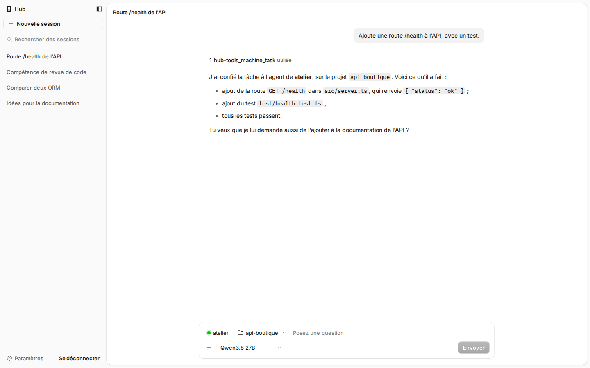
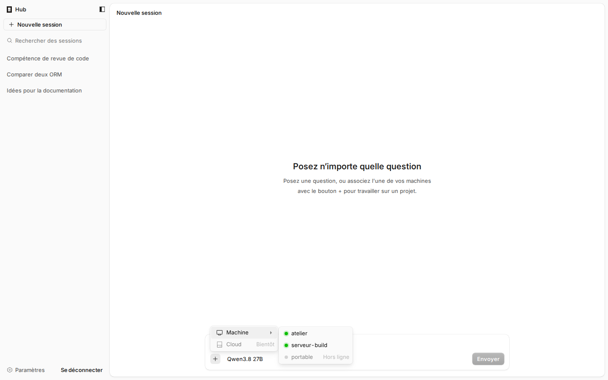
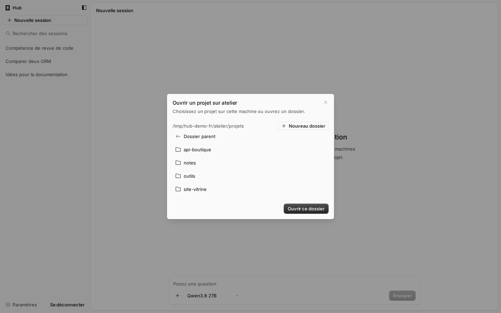
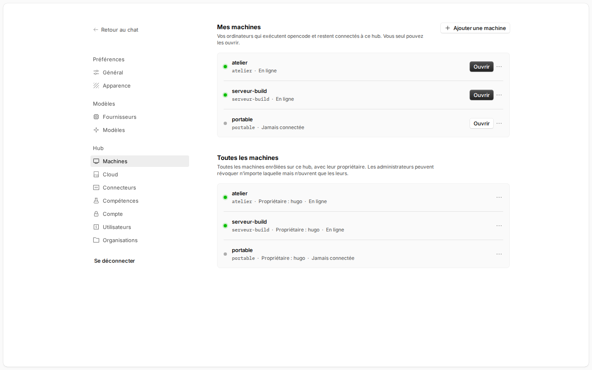
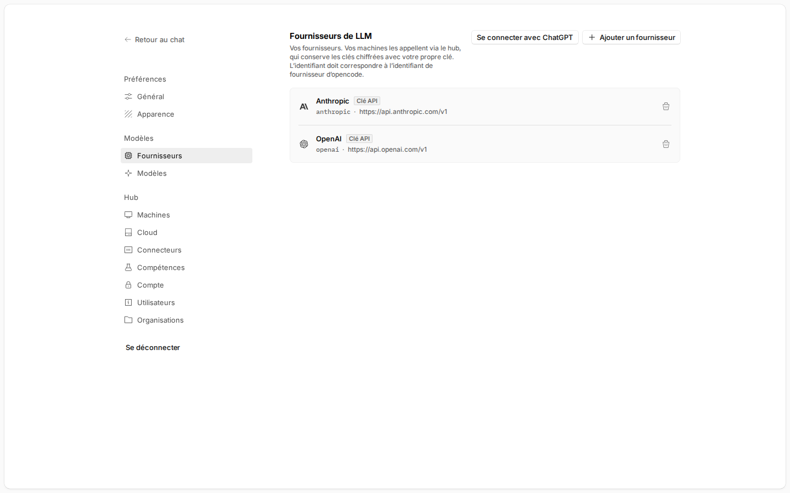

<h1 align="center">opencode-hub</h1>

<p align="center">
  <a href="README.md">Français</a> |
  <a href="README.en.md">English</a>
</p>

<p align="center">
  Un fork d'<a href="https://github.com/anomalyco/opencode">OpenCode</a> qui ajoute un <strong>hub</strong> :
  une instance publique, sur un VPS, avec un chat qui confie vos tâches aux agents de toutes vos machines.
</p>

<p align="center">
  
</p>

> [!IMPORTANT]
> **Projet indépendant.** opencode-hub n'est pas développé par l'équipe d'OpenCode et n'a aucun lien avec elle. Il est
> maintenu séparément ; pour toute question ou tout problème lié au hub, s'adresser à ce dépôt, pas au projet OpenCode.

> [!NOTE]
> **Testé et fonctionnel sur un VPS.** Le hub tourne sur un VPS Ubuntu 26.04 derrière Caddy, avec des machines Linux
> reliées comme clients. Le projet évolue encore : les interfaces, le protocole et le format des données peuvent changer
> d'une pré-version à l'autre.

## Pourquoi

OpenCode tourne sur la machine où se trouve le code. Ce fork permet d'installer une instance principale sur un serveur
accessible depuis Internet et d'y rattacher autant de machines qu'on veut (poste de travail, serveur de build, machine
de calcul…), même derrière un NAT, sans ouvrir aucun port sur elles. Depuis un seul chat, on confie une tâche à l'une
d'elles, ou l'on ouvre son interface OpenCode complète pour travailler comme si on était devant.

## Fonctionnalités

- **Chat du hub** : la page d'accueil est un chat aux codes d'OpenCode, avec ses sessions, la recherche et le choix du
  modèle. Seuls vos fournisseurs y répondent, et il ne peut ni lire de fichiers ni lancer de commandes sur le hub.
- **Tâches sur vos machines** : le bouton **+** relie la conversation à une machine connectée et à l'un de ses projets
  (ou à un nouveau dossier créé depuis le hub). L'agent de cette machine fait le travail, et le chat vous en fait la
  synthèse.
- **Compétences depuis le chat** : demander au chat de créer une compétence ou d'installer celles d'un dépôt GitHub ;
  elles sont distribuées à toutes vos machines.
- **Hub sécurisé** : comptes créés sur invitation, connexion OPAQUE (le mot de passe ne quitte jamais le navigateur),
  HTTPS automatique (Let's Encrypt via Caddy).
- **Machines distantes** : chaque machine lance `opencode agent run`, qui garde un tunnel WebSocket sortant vers le hub.
  Aucun port à ouvrir, NAT et pare-feu ne posent pas de problème.
- **Interface complète de chaque machine** : `https://<machine>.hub.exemple.fr` affiche l'interface web d'OpenCode de
  la machine elle-même, à travers le tunnel (sessions, fichiers, terminal, diffs).
- **Proxy LLM et relais MCP** : les clés des fournisseurs et les secrets des connecteurs MCP restent chiffrés sur le hub.
  Les machines n'ont qu'un jeton propre au hub ; changer une clé ne demande rien sur les machines.
- **Plusieurs utilisateurs** : chacun a ses machines, ses fournisseurs et ses compétences ; les organisations partagent
  leurs machines entre membres.
- **Catalogue de fournisseurs** : plus de 200 fournisseurs issus du catalogue d'OpenCode, l'URL de l'API déjà
  renseignée. Connexion « Sign in with ChatGPT » possible.
- **Toutes les langues d'OpenCode** : l'interface est traduite dans les 62 langues d'OpenCode.
- **Instances Cloud** *(expérimental)* : des serveurs LXD reliés au hub
  ([`agent-hub-lxd`](https://github.com/h082-orion/agent-hub-lxd)), sur lesquels chaque utilisateur crée des machines
  prêtes à l'emploi. Voir [`specs/cloud.md`](specs/cloud.md).

<p align="center">
  
  
</p>
<p align="center">
  
  
</p>

## Installer

Une seule commande, sans cloner le dépôt. Elle pose les questions une à une, télécharge la dernière version publiée, et
se relance telle quelle pour mettre à jour :

```bash
curl -fsSL https://raw.githubusercontent.com/H082-ORION/opencode-hub/remote-machines/install.sh | bash
```

Elle demande les droits administrateur (`sudo`) quand il le faut, puis ce que vous voulez faire :

| Choix | Pour |
|---|---|
| **Installer un hub public sur ce serveur** | Un VPS : Caddy et le hub, en HTTPS |
| **Relier cette machine à un hub** | Chaque machine qui travaillera pour le hub |
| **Installer un hub local, sans HTTPS** | Un essai sur votre poste |
| **Choisir les composants un par un** | Les autres cas |

### 1. Le hub, sur le VPS

1. Faire pointer le domaine du hub **et** ses sous-domaines vers le VPS : un enregistrement A (et AAAA en IPv6) pour
   `hub.exemple.fr` et pour `*.hub.exemple.fr`.
2. Ouvrir les ports **80** et **443** (l'installeur les ouvre dans `ufw` ; vérifier aussi le pare-feu de l'hébergeur).
3. Sur le VPS, lancer la commande ci-dessus et choisir **Installer un hub public sur ce serveur**. Indiquer le domaine
   (`hub.exemple.fr`) et une adresse e-mail pour les certificats ; les autres questions ont des réponses par défaut.
4. À la fin, l'installeur affiche **une seule fois** le lien qui crée le compte administrateur. L'ouvrir pour créer le
   compte. Le premier chargement prend quelques secondes, le temps que Caddy obtienne le certificat.
5. Dans **Paramètres › Fournisseurs**, ajouter au moins un fournisseur de modèles.

> [!TIP]
> Le hub doit être servi en HTTPS : sur une adresse en `http://` autre que `localhost`, le navigateur bloque le
> chiffrement du mot de passe et la création du compte échoue. L'ordre n'a pas d'importance : installer Caddy ou le hub
> en premier mène au même résultat, l'installeur reliant toujours l'un à l'autre.

### 2. Chaque machine

1. Dans le hub, **Paramètres › Machines › Ajouter une machine** : un code à usage unique s'affiche.
2. Sur la machine, lancer la même commande et choisir **Relier cette machine à un hub**. Indiquer l'URL du hub
   (`https://hub.exemple.fr`), puis le code. Accepter le service systemd pour que la machine reste reliée au démarrage.
3. La machine apparaît connectée dans le hub. Dans le chat, le bouton **+** › **Machine** lui confie des tâches.

### Mettre à jour, état, désinstallation

| Commande | Rôle |
|---|---|
| `curl … \| bash` | Mettre à jour : choisir de nouveau la même installation, la dernière version est proposée en premier |
| `curl … \| bash -s -- --status` | État de Caddy, du hub, de l'agent et du binaire |
| `curl … \| bash -s -- --uninstall` | Désinstallation (`--purge` efface aussi les données, l'enrôlement, Caddy et le binaire) |
| `curl … \| bash -s -- --help` | Toutes les options, pour une installation sans questions |

Sans aucune question, par exemple sur un serveur provisionné par script :

```bash
curl -fsSL https://raw.githubusercontent.com/H082-ORION/opencode-hub/remote-machines/install.sh \
  | bash -s -- --caddy --hub --domain hub.exemple.fr --email vous@exemple.fr --service --download --yes
```

Les binaires publiés couvrent Linux x64 et arm64 (glibc). Détails sur Caddy, le DNS et le dépannage :
[`script/hub/README.md`](script/hub/README.md).

## Architecture

```
navigateur ──https──> Caddy ──> opencode hub (127.0.0.1:4800)
                                  ├─ hub.exemple.fr            chat, paramètres, connexion, proxy LLM et MCP
                                  └─ <machine>.hub.exemple.fr  proxy vers la machine
                                            ▲
                         tunnel WebSocket sortant (initié par la machine)
                                            │
            machine : opencode agent ──> service opencode local (127.0.0.1)
```

Chaque machine fait tourner un serveur OpenCode complet : Git, terminal, fichiers et outils s'exécutent localement.
Le hub authentifie, route et relaie. Son chat s'appuie sur une instance OpenCode par utilisateur, privée de tout outil
sauf ceux du hub (compétences, tâches sur les machines). Le cœur d'OpenCode n'est pas modifié. Le détail du protocole
est dans [`specs/remote-machines.md`](specs/remote-machines.md).

## Développer

Prérequis : [Bun](https://bun.sh) (version indiquée dans `package.json`).

```bash
./build.sh                    # dépendances, tests, interface web et binaire pour cette machine
BIN=packages/cli/dist/cli-linux-x64/bin/opencode

$BIN hub                      # http://localhost:4800 ; sans compte, affiche le lien qui crée l'administrateur
$BIN agent join http://localhost:4800      # sur une machine : demande le code sans l'afficher
$BIN agent run
```

Depuis les sources sans binaire : `./build.sh --ui-only`, puis `bun run dev hub` et `bun run dev agent run`. Une
nouvelle version se publie avec `./release.sh <version>` (par exemple `1.0.0-pre.4`, ou `1.0.0` pour une stable).

## Commandes

| Commande | Rôle |
|---|---|
| `opencode hub [--port 4800] [--url https://hub.exemple.fr] [--data <dossier>] [--mcp-private-network]` | Lance le hub (`--mcp-private-network` : connecteurs MCP autorisés vers les adresses privées et de boucle locale) |
| `opencode hub invite [--admin] [--data <dossier>]` | Crée une invitation à usage unique et affiche son lien (`--admin` pour un administrateur) |
| `opencode agent join <url> [--code <code>] [--name <nom>] [--insecure]` | Enrôle cette machine (sans `--code`, le code est demandé sans affichage ou lu sur l'entrée standard) |
| `opencode agent run` | Maintient la machine connectée au hub |
| `opencode agent status` / `opencode agent leave` | État de l'enrôlement / désenrôlement |

## Sécurité de l'enrôlement

Le code d'enrôlement, puis les jetons que le hub renvoie à la machine, ne passent qu'en HTTPS : `opencode agent join`
et `install.sh` refusent une URL en `http://` vers une autre machine (seuls `localhost`, `*.localhost`, `127.x.x.x` et
`::1` restent permis en HTTP, pour les essais locaux). Ils refusent aussi un hub qui annonce une URL publique en
`http://`, car le tunnel y enverrait le jeton de la machine en clair. `--insecure` lève ces deux refus, en connaissance
de cause. Sans `--code`, le code n'apparaît ni dans la liste des processus ni dans l'historique du shell.

## Limites connues

- Une machine hors ligne n'est pas accessible : ses sessions vivent sur la machine.
- Pendant une tâche confiée à une machine, le chat montre l'outil en cours, sans suivi détaillé ; personne ne pouvant
  répondre depuis le hub, les demandes d'autorisation de l'agent distant sont refusées et signalées dans sa réponse.
- L'historique du chat est stocké en clair sur le hub, dans le dossier privé de chaque utilisateur.
- Les sessions de connexion au hub sont en mémoire : redémarrer le hub déconnecte le navigateur.
- Les abonnements Anthropic ne peuvent pas passer par le hub : OpenCode ne les utilise qu'à travers la CLI `claude`
  installée sur chaque machine.
- Si une machine a déjà une clé enregistrée pour un fournisseur proposé par le hub, c'est cette clé locale qui est
  utilisée.

## Organisation du code

| Chemin | Contenu |
|---|---|
| `packages/relay` | Hub, chat et ses outils, protocole du tunnel, agent, proxy LLM, relais MCP, catalogue |
| `packages/app/hub.html`, `packages/app/src/hub` | Interface du hub (composants `@opencode/ui` et `@opencode/session-ui`) |
| `packages/cli/src/commands/handlers/{hub,agent}` | Commandes `opencode hub` et `opencode agent` |
| `install.sh` | Installation, mise à jour, état et désinstallation (Caddy, hub, client, services systemd) |
| `build.sh`, `release.sh` | Build complet, publication d'une version |
| `specs/` | Spécifications |

## OpenCode

Tout le reste est [OpenCode](https://github.com/anomalyco/opencode), développé par son équipe. opencode-hub n'est pas
développé par l'équipe d'OpenCode et n'est affilié à elle d'aucune manière. Le README d'origine est
conservé dans [`README.opencode.md`](README.opencode.md). Ce fork suit la branche `dev` de l'amont ; le hub est
développé sur la branche `remote-machines`.

Licence : MIT, comme OpenCode ([`LICENSE`](LICENSE)).

## Remerciements

Un grand merci à l'équipe d'[OpenCode](https://github.com/anomalyco/opencode), et toutes nos félicitations pour son
excellent travail. opencode-hub n'existerait pas sans elle : le serveur, l'interface web, le terminal, le catalogue des
fournisseurs, tout ce que le hub rend accessible à distance, c'est OpenCode. Merci aussi de l'avoir publié en logiciel
libre, ce qui permet à des projets comme celui-ci de construire par-dessus.
